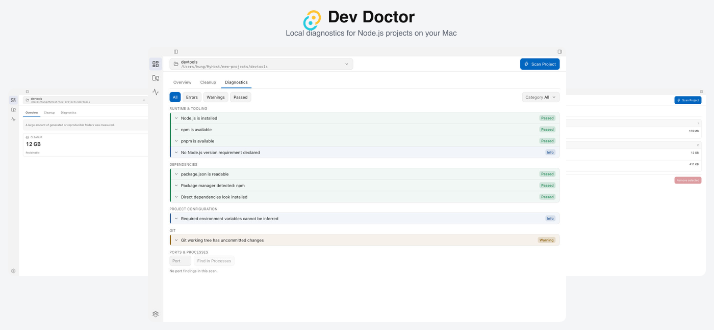

<div align="center">


# Dev Doctor

**A local-first macOS app to diagnose projects, reclaim disk space, inspect dev processes, and watch system health — without sending your code anywhere.**

<br>


[Download for macOS](https://github.com/hulk-pham/Dev-Doctor/releases/latest) · [Documentation](docs/documentation.md) · [Report a bug](https://github.com/hulk-pham/Dev-Doctor/issues/new?template=bug_report.yml) · [Contributing](#contributing)

</div>

## Table of Contents

- [Screenshots](#screenshots)
- [Why Dev Doctor?](#why-dev-doctor)
- [Features](#features)
- [Privacy & Safety](#privacy--safety)
- [Installation](#installation)
- [Getting Started](#getting-started)
- [Documentation](#documentation)
- [Build from Source](#build-from-source)
- [Contributing](#contributing)
- [License](#license)

## Screenshots



The app runs natively on macOS with a quiet, editor-like UI: one project selector across every screen, clear next steps after a scan, and confirm dialogs before anything destructive runs.

## Why Dev Doctor?

Development machines collect build output, heavy dependency folders, stale dev servers, and small configuration mistakes that are painful to chase by hand. Dev Doctor puts **measurement**, **diagnostics**, and **safe actions** in one place on your Mac.

It is built for developers who already know their repo path and want answers like “what can I delete?”, “why won’t this run?”, and “what holds port 3000?” — not another dashboard that hides the next step.

A folder that contains several projects is listed so you can open one project at a time. A folder with no manifest does not get Node.js or npm checks.

## Features

| Area | What you get |
| --- | --- |
| **Overview** | Reclaimable disk, diagnostic counts, **system health** (CPU, memory pressure, disk), and one obvious next step. |
| **Project cleanup** | Generated and reproducible folders with **measured** sizes. Nothing is deleted until you confirm paths and consequences. |
| **Diagnostics** | Toolchain, lockfiles, environment variable **names**, Git, and ports — each row explains what is wrong and what to try next. |
| **Processes** | Dev processes on this Mac with listen ports, search by name or port, and optional **resource trends** and **watchdog alerts** (local SQLite history when available). |
| **Projects** | Scan history so you can reopen a folder with the last result. |

Background sampling (optional, off by default) watches CPU, memory pressure, disk, and dev processes on an interval you control. Alerts stay on the machine; they never kill or delete on their own.

## Privacy & Safety

- **Local-first** — Scans, cleanup history, and monitoring samples stay in your app data folder. No account and no telemetry.
- **Secrets** — `.env` **values** are dropped before a snapshot exists; only variable names may appear in diagnostics.
- **Measured, not guessed** — Sizes and ports come from the OS. Copy does not imply continuous monitoring or a complete process list.
- **Confirm before change** — Deletes, process stops, and package installs run only after an in-app confirm. Installs are limited to `npm install --ignore-scripts` or `pnpm install --ignore-scripts`.
- **Updates** — **Check for Updates** asks GitHub for the latest release tag and notes. It does not upload project paths or file contents.

History paths are shown on **Settings**. You can clear monitoring history there when you want a fresh start.

## Installation

**Requirements:** macOS 15+, Apple silicon build (see [Install troubleshooting](docs/install.md) for Intel and Gatekeeper).

The current release is **0.4.0** for Apple silicon.

1. Download the latest [Dev Doctor disk image](https://github.com/hulk-pham/Dev-Doctor/releases/latest) (`Dev Doctor_0.4.0_aarch64.dmg` or newer on that page).
2. Open the disk image and drag **Dev Doctor** to **Applications**.
3. First launch: the build is **unsigned and not notarized**. Right-click the app → **Open** → **Open** again. If macOS still blocks it, follow [docs/install.md](docs/install.md).

Release notes: [CHANGELOG.md](CHANGELOG.md). To verify what you run, read [CONTRIBUTING.md](CONTRIBUTING.md) and build from source.

## Getting Started

1. Open Dev Doctor and **select a project folder** (or drop a folder on the window).
2. Click **Scan Project** and wait for Overview — reclaimable bytes and diagnostic counts appear together.
3. Follow the next step into **Cleanup** or **Diagnostics** from Overview.
4. Use **Processes** when you need ports or dev servers on this machine; open **Trends** or **Alerts** from the same screen for optional sampling.
5. Confirm any cleanup, install, or process stop before it runs.

Recent folders appear in the project menu and under **Projects**.

## Documentation

| Doc | Purpose |
| --- | --- |
| [User guide](docs/documentation.md) | Screen-by-screen behavior and workflows |
| [Install troubleshooting](docs/install.md) | Gatekeeper, quarantine, PATH, Intel Mac |
| [Development](docs/development.md) | Architecture, tests, release build |
| [Contributing](CONTRIBUTING.md) | Verify from source, PR expectations |
| [Product roadmap](docs/roadmap/06-monitor-diagnose-fix.md) | Monitoring, alerts, and planned AI phases |

## Build from Source

**Requirements:** macOS, Node.js 20+, Rust, Xcode Command Line Tools.

```bash
git clone https://github.com/hulk-pham/Dev-Doctor.git
cd Dev-Doctor
npm install
npm run tauri dev
```

Release bundle: `npm run tauri build` (output under `src-tauri/target/release/bundle/`). Signing, tests, and agent workflow: [docs/development.md](docs/development.md).

## Contributing

Issues and pull requests are welcome.

- **Bug or idea:** [Bug report](https://github.com/hulk-pham/Dev-Doctor/issues/new?template=bug_report.yml) or [feature request](https://github.com/hulk-pham/Dev-Doctor/issues/new?template=feature_request.yml).
- **Code:** Fork, branch from `main`, open a PR. Run `npm test`, `npm run typecheck`, and for Rust changes `cargo test --manifest-path src-tauri/Cargo.toml`.
- **README screenshots:** `npm run screenshots:showcase` (see [docs/development.md](docs/development.md)).

There is no GitHub Actions workflow in this repo yet; those commands are the pre-push check.

## License

[MIT](LICENSE), with a plain-language notice in front of the legal text.

The notice explains that the release build has no Apple Developer ID and is not notarized, points to the files that limit deletes and commands, and restates that there is no warranty. It does not add restrictions beyond MIT.
